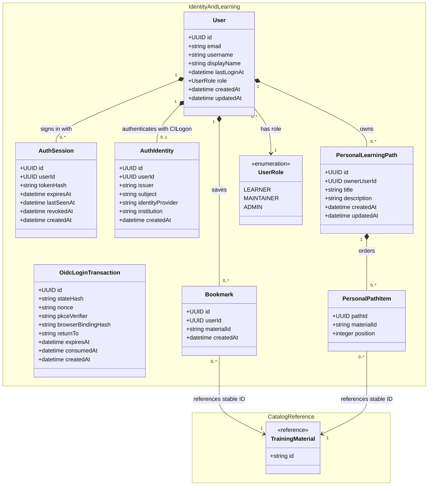

# CILogon Authentication and Local Authorization Design

The target model uses CILogon OpenID Connect for sign-in and local application
sessions and roles for authorization. Public catalog access remains unauthenticated.

The entity model below is implemented and registered with TypeORM, and its
CILogon migration is checked in. The CILogon endpoints are still pending. The authentication flow and CILogon routes
below describe the intended next increment.

## Identity and persistence model

- Keep a local `User` UUID, required unique username, nullable unique email,
  nullable display name and last-login time, role, and managed timestamps.
  The entity no longer stores `passwordHash`.
- Link `AuthIdentity` to `User` through a required, unique `userId`. The unique
  `(issuer, subject)` pair identifies the external account. Store the validated
  CILogon `iss` and `sub` exactly; email and username are profile fields rather
  than authentication keys. Optional identity-provider and institution metadata
  may be absent. User deletion cascades to the identity.
- Use `OidcLoginTransaction` during the browser redirect and code exchange.
  It replaces `AuthChallenge` and has no user relation because the person is
  not identified when sign-in starts. Its fields are described below.
- Create `AuthSession` after CILogon validation succeeds. Its hashed token, expiry, and
  revocation state allow logout and server-side session invalidation.
- Each user has exactly one `UserRole`: `LEARNER`, `MAINTAINER`, or `ADMIN`.
  `ADMIN` lists accounts and changes roles; `MAINTAINER` is reserved for
  future content management; all authenticated roles can own personal paths.
- `PersonalLearningPath` belongs to one user, and `PersonalPathItem` stores its
  ordered material references. All personal path operations are scoped to the
  session user, including requests made by administrators.
- `Bookmark` belongs to one user and references one catalog material. Personal
  path creation and item replacement require every submitted material to be
  bookmarked by the session user.



`User.email`, `displayName`, and `lastLoginAt` are nullable. The username remains
required and unique; new-user provisioning must assign an application username
when provider claims do not supply a suitable value. PostgreSQL's unique email
constraint permits multiple null values but rejects duplicate non-null addresses.
An email collision must not silently link a different issuer/subject to an account.
The issuer/subject constraint and one-to-one relation prevent an identity from
belonging to multiple users and a user from having multiple linked identities.
Provisioning must create the user and identity atomically; the database relation
alone does not require every user row to already have an identity.

The login-transaction table has the following fields:

| Field                | Storage and purpose                                                                                       |
| -------------------- | --------------------------------------------------------------------------------------------------------- |
| `id`                 | Generated UUID primary key.                                                                               |
| `stateHash`          | Required text, unique; matches the returning authorization state.                                         |
| `nonce`              | Required text; validates that the ID token belongs to the attempt.                                        |
| `pkceVerifier`       | Required temporary secret; excluded from default TypeORM selects and explicitly loaded for code exchange. |
| `browserBindingHash` | Required text; binds the attempt to a temporary browser cookie.                                           |
| `returnTo`           | Nullable text; service code must validate the destination before storing or using it.                     |
| `expiresAt`          | Required timestamp, indexed for expiry lookup and cleanup.                                                |
| `consumedAt`         | Nullable timestamp; records single-use consumption.                                                       |
| `createdAt`          | Database-managed creation timestamp.                                                                      |

Properties map to snake-case columns in `auth_identities` and
`oidc_login_transactions`. Neither table stores a provider access or refresh token.
The local session table remains unchanged. State, nonce, browser binding, expiry,
atomic consumption, and cleanup are service responsibilities; declaring the
columns does not implement those checks. `select: false` limits accidental
selection of the verifier but does not encrypt it or expire the record.

No existing accounts need to be preserved for this development switch.
The CILogon migration adds both tables and alters `users`. The unused
`auth_challenges` table and `auth_challenge_purpose_enum` still require a separate
cleanup migration. Keep historical migrations intact. TypeORM synchronization remains disabled, so entity changes alone do not
update PostgreSQL or the committed database snapshot.

## Authentication flow

1. Browser navigation to the planned `GET /auth/cilogon/login` creates a
   short-lived `OidcLoginTransaction` and temporary HttpOnly browser-binding
   cookie. The response redirects to CILogon with state, nonce, and a PKCE
   `S256` challenge using authorization-code flow.
2. CILogon authenticates through the selected identity provider and redirects
   the browser to the registered `GET /auth/cilogon/callback` with code and state.
   The backend checks state, browser binding, expiry, and single-use status,
   then atomically consumes the attempt. A failed or replayed attempt cannot
   establish a session.
3. The backend exchanges the code using its client credentials and stored PKCE
   verifier. Use an OIDC library to validate the ID token's signature, expected
   issuer, audience, expiry, and nonce. The network exchange runs outside a
   long-lived database transaction. Provider tokens stay server-side.
4. Look up `AuthIdentity` using validated issuer and subject. On first sign-in,
   create the local `LEARNER` user, identity, and session in one transaction;
   handle concurrent first sign-ins through the identity's unique constraint.
   Returning users retain their local UUID and role. Generate a fresh opaque
   application token, store its SHA-256 hash in `AuthSession`, and set the
   existing session cookie only after commit. Clear the temporary cookie and
   redirect to an approved frontend destination.
5. Every protected request resolves the cookie to a non-revoked, unexpired
   session, then derives the user and role server-side.
6. Administrator routes run `SessionAuthGuard` followed by `AdminAuthGuard`.
   The first establishes the current identity; the second requires `ADMIN`.
   Roles are read from the database on each request, so a role change applies to
   existing sessions on their next request.
7. Logout awaits revocation of the current session, then clears its cookie with
   matching cookie settings. Other sessions belonging to the account remain valid.

The old email-code attempt limit and ten-minute challenge lifetime do not apply
to OIDC transactions. Their lifetime and cleanup policy still need to be selected.
Existing local sessions use a 24-hour lifetime. The target flow reuses that policy;
local logout does not automatically end the institution's identity-provider session.

The development cookie is named `session` and permits local HTTP testing.
With `NODE_ENV=production`, the name is `__Host-session` and Secure is enabled.
Both use HttpOnly, SameSite=Lax, path `/`, and the session expiration. No Domain
attribute is set. The raw token is never returned in JSON.

## API surface and roles

All routes below use the `/api/v1` prefix. The table describes the target API;
the two CILogon routes are planned, and existing protected routes retain their
session and role behavior after the switch.

| Endpoint                             | Access        | Purpose                                                                            |
| ------------------------------------ | ------------- | ---------------------------------------------------------------------------------- |
| `GET /auth/cilogon/login`            | Public        | Start sign-in and redirect to CILogon; planned.                                    |
| `GET /auth/cilogon/callback`         | Public        | Validate sign-in, provision/find the user, and establish a local session; planned. |
| `POST /auth/logout`                  | Authenticated | Revoke the current session.                                                        |
| `GET /me`                            | Authenticated | Return the current account and role.                                               |
| `GET /users`                         | `ADMIN`       | List account summaries without credentials.                                        |
| `PATCH /users/{userId}/role`         | `ADMIN`       | Assign `LEARNER`, `MAINTAINER`, or `ADMIN`.                                        |
| `GET /me/bookmarks`                  | Authenticated | List the caller's saved materials.                                                 |
| `POST /me/bookmarks`                 | Authenticated | Save an existing material.                                                         |
| `DELETE /me/bookmarks/{materialId}`  | Authenticated | Remove the caller's bookmark.                                                      |
| `GET /me/learning-paths`             | Authenticated | List the caller's personal learning paths.                                         |
| `POST /me/learning-paths`            | Authenticated | Create a personal learning path.                                                   |
| `GET /me/learning-paths/{pathId}`    | Authenticated | Read one caller-owned personal learning path.                                      |
| `PATCH /me/learning-paths/{pathId}`  | Authenticated | Update one caller-owned personal learning path.                                    |
| `DELETE /me/learning-paths/{pathId}` | Authenticated | Delete one caller-owned personal learning path.                                    |

`MAINTAINER` is reserved for future content-management endpoints. It has no
V1 content-authoring endpoint. First sign-in will create `LEARNER` accounts;
clients and provider claims cannot assign a role. Bootstrap administrators need
a controlled promotion process after CILogon sign-in.

## Endpoint payloads

`GET /auth/cilogon/login` is planned as a browser navigation endpoint with no
request body. It will create the attempt and return a `302` redirect to CILogon.
Any optional return destination must be restricted to approved frontend locations.

`GET /auth/cilogon/callback` is planned to receive the authorization code and
state as query parameters, or a provider error if sign-in was cancelled.
It will establish the local session and redirect to the frontend after successful
validation and persistence. The browser does not receive provider tokens or the
PKCE verifier. Callback error responses and the exact return-destination policy
remain part of [D-04](contracts/decisions-needed.md#D-04).

Current account summaries contain `id`, `email`, `username`, and `role`.
Response DTOs and consumers need to support nullable email. `displayName` and
`lastLoginAt` are entity fields and are not automatically exposed by existing DTOs.

`POST /auth/logout` has no body. It returns `204 No Content`, revokes the
current session, and clears its cookie.
Missing, expired, or revoked sessions return `401`, including repeated logout
requests. Logout does not delete the session row.

`GET /me` has no body. It returns `200 OK` with the authenticated user's
`id`, `email`, `username`, and `role`.

`GET /users` has no body and requires an `ADMIN` session. It returns `200 OK`
with an array of account summaries containing `id`, `email`, `username`, and
`role`, in creation order. Identity secrets and session data are not exposed.

`PATCH /users/{userId}/role`

```json
{ "role": "MAINTAINER" }
```

Requires an `ADMIN` session. Returns `200 OK` with the target user's `id`,
`email`, `username`, and updated `role`. An administrator cannot demote the
final administrator; that attempt returns `409 Conflict`. A missing target
returns `404 Not Found`, an invalid UUID or role returns `400 Bad Request`, and
setting the existing role succeeds without changing it. To demote a user,
send `{ "role": "LEARNER" }` to this same endpoint.

Role changes use a `READ COMMITTED` transaction and share a PostgreSQL transaction
advisory lock. The acting user's admin role is checked again after acquiring
the lock, and the target row is locked before changing it. The admin count is
checked inside the transaction before a demotion. Concurrent demotions therefore
cannot both pass a stale count, and an actor demoted while waiting for the lock
receives `403`. An administrator can change their own role if another admin
remains; their existing session reflects the new role on the next request.

`GET /me/learning-paths` has no body and returns `200 OK` with an array of the
caller's paths. Each path contains `id`, `title`, `description`, `createdAt`,
`updatedAt`, and ordered `items`.
The list is ordered by `updatedAt` descending, with `id` as the tie breaker.
It returns `[]` when the caller has no paths and includes paths with no items.
Each item contains `materialId` and `position`, ordered by ascending position.

`POST /me/learning-paths`

```json
{
  "title": "My GPU learning plan",
  "description": "Optional notes",
  "items": [
    { "materialId": "material-001", "position": 0 },
    { "materialId": "material-002", "position": 1 }
  ]
}
```

Returns `201 Created` with the complete path. The owner is derived from the
session; clients never submit `ownerUserId`.

Titles are trimmed, must be nonblank, and are limited to 200 characters.
Descriptions may be omitted or null and are limited to 5000 characters.
Items may be omitted or empty, with at most 1000 entries per path. Each entry
must be an object containing a nonblank `materialId` of at most 254 characters
and an integer `position` between zero and 2,147,483,647. Material IDs and
positions must each be unique within the path; gaps in positions are allowed.
Material IDs must exist and be bookmarked by the caller, including when they
belong to older catalog snapshots. An unbookmarked material returns `400`.
Creating the path and its items is one transaction.

`GET /me/learning-paths/{pathId}` has no body and returns `200 OK` with the
complete path only when it belongs to the current user. A missing or
non-owned path returns `404 Not Found`.

`PATCH /me/learning-paths/{pathId}` accepts any supplied combination of
`title`, `description`, and `items`. If `items` is included, it replaces the
full ordered item list in one transaction. It returns `200 OK` with the
updated complete path.

Omitted fields remain unchanged. `items: []` removes all items, and
`description: null` clears the description. An empty body, null title, or null
items value returns `400`. The same validation rules apply as on creation.
The owner-scoped path row is locked during the transaction, and material
references are validated before replacing items. A failed replacement leaves
the previous path and items intact. Item-only updates also refresh `updatedAt`.
Removing a bookmark does not delete existing path items. Updates that omit
`items` still work; resubmitting an item whose bookmark was removed requires
bookmarking that material again.

`DELETE /me/learning-paths/{pathId}` has no body and returns `204 No Content`.
It can delete only a path owned by the current user.
Its items are deleted through the database cascade. A missing or non-owned path
returns `404`, including a repeated deletion. Invalid path UUIDs return `400`
for detail, update, and delete requests.

Malformed request bodies return `400 Bad Request`; missing/invalid session
cookies return `401 Unauthorized`; and attempts to use an admin-only role
endpoint without `ADMIN` return `403 Forbidden`.

Unexpected body fields are rejected, including client-supplied ownership or
role fields on learner-owned operations. Existing JSON API errors use `statusCode`, `error`,
`timestamp`, `message`, and `path`; validation messages may be arrays.

## Local setup and verification

Apply the CILogon authentication migration before using the new schema.
When restoring the committed catalog snapshot, restore it first and then apply
any newer migrations. `migration:run` alone cannot create a migration that has
not been checked in. See the [README database model](../README.md#authentication-database-model).

Register a confidential CILogon client with the exact backend callback URL.
Client credentials belong in server configuration. Request `openid email profile`
and add `org.cilogon.userinfo` only when the optional provider metadata is needed.
CILogon can omit email and name even when requested. Its
[OIDC documentation](https://www.cilogon.org/oidc) describes registration,
discovery, claims, and PKCE. The client integration and configuration are still pending.

Set `ADMIN_USER_ID` to the UUID of a local user with a linked CILogon identity,
then run `npm run seed:admin` to promote that account. The script does not create
users or identify accounts by email.

Entity metadata tests verify table registration, nullable profile fields,
identity uniqueness and cascade behavior, login-transaction fields and indices,
and unchanged session relationships. They do not apply migrations or verify
CILogon authentication. Run them without a database connection:

```bash
npm test -- --runInBand src/database/entities/persistence.entities.spec.ts src/database/database.module.spec.ts
```

The existing Postman collection covers personal path CRUD, ownership, validation,
administrator access, and role changes with local sessions.
`npm run test:api` starts the API and runs the collection against a
populated test database, cleaning up temporary users and dependent data.
The runner bookmarks the selected materials for the personal-path owner.
See [the README](../README.md#postman-api-tests) for the existing commands and variables.
